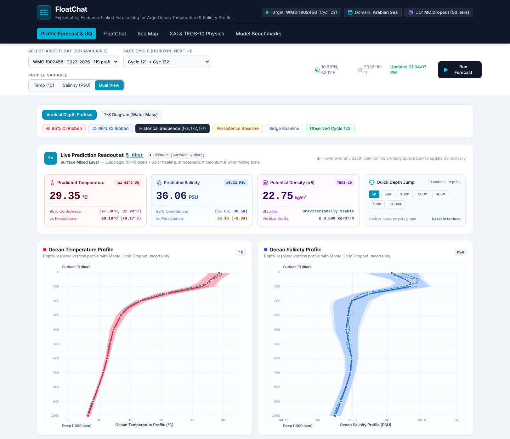
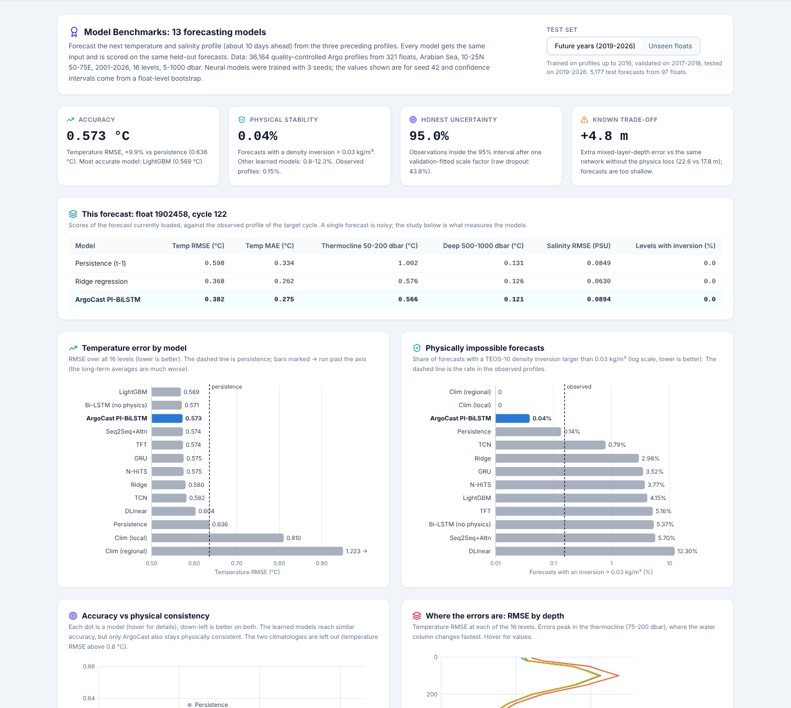

# ArgoCast

[](https://doi.org/10.5281/zenodo.23422343)
[](https://doi.org/10.5281/zenodo.23423759)
[](https://github.com/VighneshKunjir/ArgoCast/releases)
[](LICENSE)
[](https://github.com/VighneshKunjir/ArgoCast/stargazers)


**Physics-informed, explainable forecasting of Argo ocean temperature and salinity profiles in the Arabian Sea.**

ArgoCast forecasts the next temperature and salinity profile of an Argo float (16 levels, 5 to 1000 dbar, about 10 days ahead) from its three most recent profiles. Every forecast comes with:

- **Physical checks.** The model is trained with a TEOS-10 static-stability penalty, so it almost never puts denser water above lighter water. Each forecast is re-checked with the official `gsw` (TEOS-10) library.
- **Calibrated uncertainty.** Monte Carlo dropout (50 passes) gives 90% and 95% intervals, rescaled on validation data so that the 95% interval really contains about 95% of observations.
- **Explanations.** Integrated Gradients shows how much each past profile and each input depth contributed to the forecast.
- **Evidence links.** The three most similar quality-controlled historical profiles, with their Argo GDAC file paths.
- **Grounded chat.** Questions about the profile are answered from the database, the forecast and the benchmark results, with an optional Gemini model and a fully offline fallback.



---

## Results

ArgoCast PI-BiLSTM was compared with 12 baselines on 36,164 quality-controlled Argo profiles from 321 floats (Arabian Sea, 10-25 N, 50-75 E, 2001-2026), on two test sets:

- **Future years:** trained on data up to 2016, tested on 2019-2026 (5,177 forecasts, 97 floats).
- **Unseen floats:** tested on 45 floats never used in training (4,341 forecasts).

| Model | Temp RMSE (°C), future years | Temp RMSE (°C), unseen floats | Forecasts with a density inversion > 0.03 kg/m³ |
|---|---|---|---|
| Persistence (repeat last profile) | 0.636 | 0.650 | 0.14% / 0.05% |
| Ridge regression | 0.580 | 0.594 | 2.97% / 2.30% |
| LightGBM | **0.569** | 0.580 | 4.15% / 5.09% |
| Temporal Fusion Transformer | 0.574 | 0.587 | 5.16% / 5.76% |
| Bi-LSTM without physics loss | 0.571 | **0.579** | 5.37% / 5.46% |
| **ArgoCast PI-BiLSTM** | 0.573 | 0.580 | **0.04% / 0.02%** |
| Observed profiles (reference) | | | 0.15% / 0.07% |

- ArgoCast is about 10% more accurate than persistence and within 0.005 °C of the most accurate model on both test sets.
- It is the only model whose forecasts are almost always physically stable: 0.02-0.04% unstable forecasts, against 0.8-12.3% for the other learned models.
- After calibration, its 95% intervals cover 95.0% and 95.4% of observations (raw Monte Carlo dropout: 44-47%).
- Known trade-off: the stability penalty makes the forecast mixed layer about 4 m too shallow. A surface-stratification loss term removes most of this error but allows more small inversions (see the Benchmarks tab).

All 13 models, extended metrics (bias, ACC, CRPS, errors by depth and season, mixed layer depth, 20 °C isotherm depth, heat content), the mixed-layer experiment and the comparison of explanation methods are shown in the app's **Model Benchmarks** tab.



---

## Quick start

Requirements: **Python 3.10+** and **Node.js 20+**. A GPU is not needed to run the app.

### 1. Backend (FastAPI, port 8000)

```bash
cd backend
python -m venv .venv
# Windows: .venv\Scripts\activate      macOS/Linux: source .venv/bin/activate
pip install -r requirements.txt

python scripts/seed_database.py        # loads the 36,164 profiles into SQLite (about 5 s)
uvicorn app.main:app --port 8000
```

API documentation is then available at http://localhost:8000/docs.

### 2. Web app (port 3000)

In a second terminal, from the project root:

```bash
npm install
npm run dev
```

Open http://localhost:3000. The web server forwards every `/api` request to the backend.

### 3. Optional settings

Copy `.env.example` to `.env`. Add `GEMINI_API_KEY` to let the chat use a Gemini model; without it the chat answers from its built-in grounded templates and everything works offline. `DATABASE_URL` switches the database to PostgreSQL.

### Tests

```bash
cd backend
pytest
```

The tests build their own temporary database, so they do not touch `backend/data/argocast.db`.

---

## How to use the app

| Tab | What it shows |
|---|---|
| **Profile Forecast & UQ** | Forecast temperature and salinity profiles with 90% / 95% bands, the three input profiles, persistence and Ridge baselines, and the observed profile when it exists. Below it, the evidence-link citations. |
| **Ask ArgoCast** | Questions about the selected profile: thermocline, salinity, stability, uncertainty, explanations, mixed layer, model accuracy. |
| **Sea Map** | All floats in the region and the recorded positions of the selected float around the forecast. The map background (bathymetry, temperature and salinity shading) is illustrative. |
| **XAI & TEOS-10 Physics** | Integrated Gradients weights for the three input cycles, the depth-to-depth attribution matrix, and the TEOS-10 density, buoyancy frequency and stability of the forecast. |
| **Model Benchmarks** | The full 13-model study described above. |

Select a float and a **base cycle**. The forecast is for the float's next profile. If that profile is already in the archive, it is drawn for comparison and the forecast is scored; for a float's latest cycle the forecast is a true look-ahead.

---

## Project structure

```
ArgoCast_v6/
├── src/                          React 19 + TypeScript web app
│   ├── components/               one component per tab, charts in components/benchmark/
│   ├── services/api.ts           calls to the backend
│   └── types.ts
├── server.ts                     Node server: /api proxy + Vite (dev) or dist/ (production)
├── backend/
│   ├── app/                      FastAPI application
│   │   ├── api/                  endpoints: floats, forecast, chat, benchmark, model, health
│   │   ├── core/                 TEOS-10 physics, MC-dropout uncertainty, evidence links
│   │   ├── ml/                   model, physics-informed loss, Integrated Gradients
│   │   │   └── artifacts/        trained weights, scalers, Ridge baseline, calibration, benchmark results
│   │   ├── models/, schemas/, db/
│   │   └── main.py
│   ├── data/processed/           argo_arabian_2000_2026.csv.gz (the dataset)
│   ├── scripts/                  seed_database.py, export_model_artifacts.py, build_benchmark_summary.py
│   ├── research/                 code that produced the dataset, the model and the results
│   │   ├── pipeline/             download, quality control, splits, evaluation, XAI comparison
│   │   └── benchmark/            13-model benchmark and mixed-layer experiment
│   ├── tests/
│   └── requirements.txt
└── docs/screenshots/
```

## API

| Method | Endpoint | Description |
|---|---|---|
| GET | `/api/health` | Service status |
| GET | `/api/floats` | Floats with their cycles and date range |
| GET | `/api/profiles/{wmoId}` | All stored profiles of a float |
| POST | `/api/forecast` | `{"wmoId": "1902458", "cycle": 121}`: forecast, uncertainty, physics, attributions, evidence |
| POST | `/api/chat` | `{"query": "...", "wmoId": "...", "cycle": 121}`: grounded answer with citations |
| GET | `/api/model` | Provenance and held-out scores of the served model |
| GET | `/api/benchmark` | Condensed benchmark results used by the Benchmarks tab |

---

## Model

- **Architecture:** 2-layer bidirectional LSTM, 128 units per direction, dropout 0.2, separate linear heads for temperature and salinity (569k parameters).
- **Input:** the last three profiles (3 × 32 values: 16 temperatures and 16 salinities), standardised per depth.
- **Loss:** MSE(T) + 2.5 · MSE(S) + 10 · stability penalty + 1.5 · thermocline-gradient term. The stability penalty is a hinge on any decrease of potential density with depth, computed in physical units.
- **Training:** AdamW (learning rate 1e-3), cosine schedule, early stopping on validation temperature RMSE.

## Reproducing the results

The served model and every number in the Benchmarks tab can be rebuilt from public Argo data. Install the extra packages first:

```bash
cd backend
pip install -r research/requirements.txt
```

1. **Dataset:** download, quality control, interpolation and splits (several GB of downloads):
   ```bash
   cd research/pipeline
   python run_all.py --to 3
   ```
   The methods are documented in `research/pipeline/EXPERIMENT_PROTOCOL.md`.
2. **Benchmark** (CUDA GPU recommended; add `--allow-cpu` otherwise):
   ```bash
   cd ../benchmark
   python run_benchmark.py
   python mld_fix_experiment.py
   ```
3. **Explanation-method comparison** (Integrated Gradients vs LIME vs KernelSHAP):
   ```bash
   cd ../pipeline
   python run_all.py --from 4 --to 5
   ```
4. **Serve the new model and refresh the app** (from `backend/`):
   ```bash
   python scripts/export_model_artifacts.py \
       --checkpoint research/benchmark/outputs/arabian2000_chronological/models/ArgoCast_PI-BiLSTM_seed42.pt \
       --proc-dir research/pipeline/data/processed
   python scripts/build_benchmark_summary.py
   python scripts/seed_database.py --reset --csv research/pipeline/data/processed/profiles_arabian_2000_2026.csv.gz
   ```

---

## Data

Profiles come from the Argo Global Data Assembly Centres (delayed-mode and adjusted real-time data, QC flags 1 and 2). These data were collected and made freely available by the International Argo Program and the national programs that contribute to it (https://argo.ucsd.edu, https://www.ocean-ops.org). The Argo Program is part of the Global Ocean Observing System.

Argo (2000). Argo float data and metadata from Global Data Assembly Centre (Argo GDAC). SEANOE. https://doi.org/10.17882/42182

## Authors

Vighnesh Walmik Kunjir, M.Tech Computer Science and Engineering (Data Science And Analytics) MIT World Peace University, Pune, India.
