# FloatChat - Extended Evaluation on All Arabian Sea Argo Floats (2000-2026)

Record generated 2026-10-13 01:56 by `experiments/arabian_sea_2000_2026/s06_report.py`. All values below are read directly from the pipeline output files in `outputs/tables/`.

## 1. Data

| Item | Value |
|---|---|
| Region | 10-25 N, 50-75 E (Arabian Sea) |
| Period | 2000-2026 |
| Source | Argo GDAC (IFREMER, US GODAE fallback), per-float `*_prof.nc` files |
| Floats with >=1 profile in box (index) | 405 |
| Profiles in box (index, all modes) | 58,563 |
| Float files that failed to download | 0 |
| Clean profiles kept | 36,164 |
| Floats with clean profiles | 321 |
| Date range of clean profiles | 2001-12-18 to 2026-10-11 |
| Data modes kept | DA -> D: 31,313, A: 4,851 |
| Observed profiles statically stable (TEOS-10) | 84.6% |
| Forecast windows (3 -> 1) | 31,607 |
| Windows rejected by time-gap rule | 3,616 (steps outside 3-20 days) |

Cleaning log (profiles removed at each rule):

| Rule | Profiles |
|---|---|
| kept | 36,164 |
| fewer than 10 good levels | 10,608 |
| outside box | 15,455 |
| insufficient depth coverage | 7,229 |
| no position or date | 226 |
| descending profile | 56 |
| mode R excluded | 4,271 |
| bad position or date qc | 186 |
| duplicate cycle removed | 0 |
| profiles examined | 74,195 |

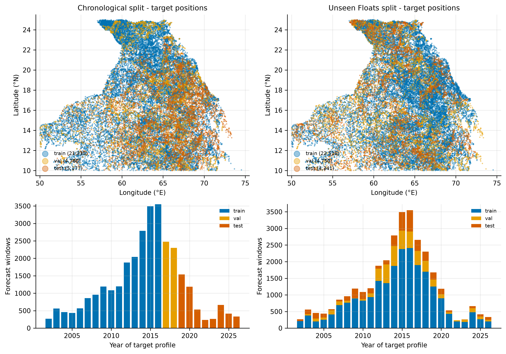

*Figure 1. Target-profile positions and yearly window counts for both splits.*

## 2. Train / validation / test splits

Two leakage-safe splits are used. Scalers are fitted on the training part only.

- **Chronological (primary).** Train on the past, test on the future. Windows are assigned by the date of the target profile: validation from 2017-01-01, test from 2019-01-01. Boundaries sit on 1 January near the 70 % / 85 % points of the timeline. Windows whose inputs straddle a boundary are purged (315 windows), so no test input was a training target.
- **Unseen floats (generalisation).** 70 / 15 / 15 of floats, stratified by each float's median year, seed 42. Test floats are never seen during training.

| Split | Part | Windows | Floats | First target | Last target | Share |
|---|---|---|---|---|---|---|
| chronological | train | 21,335 | 217 | 2002-01-17 | 2016-12-31 | 67.5% |
| chronological | val | 4,780 | 90 | 2017-01-12 | 2018-12-31 | 15.1% |
| chronological | test | 5,177 | 97 | 2019-01-13 | 2026-10-11 | 16.4% |
| unseen floats | train | 22,516 | 202 | 2002-01-17 | 2026-10-11 | 71.2% |
| unseen floats | val | 4,750 | 45 | 2003-06-22 | 2026-10-06 | 15.0% |
| unseen floats | test | 4,341 | 45 | 2002-05-04 | 2026-10-09 | 13.7% |

## 3. Forecast accuracy - chronological split

Test set: 5,177 windows from 97 floats. RMSE in physical units; 95 % CI from a float-level block bootstrap (1000 resamples). Neural models: seed 42 for the CI columns, mean +/- std over seeds 42, 43, 44 in the last columns.

| Model | T RMSE (C) | T 95% CI | T MAE | Thermocline RMSE 50-150 | Deep RMSE 500-1000 | T R2 | S RMSE (PSU) | S 95% CI | S R2 | Inversions TEOS-10 (%) | Inversions poly (%) | T RMSE seeds | S RMSE seeds |
|---|---|---|---|---|---|---|---|---|---|---|---|---|---|
| Persistence | 0.636 | [0.600, 0.674] | 0.375 | 1.061 | 0.192 | 0.992 | 0.140 | [0.133, 0.146] | 0.874 | 16.67 | 27.95 | - | - |
| Climatology | 1.223 | [1.137, 1.308] | 0.866 | 1.834 | 0.478 | 0.969 | 0.264 | [0.243, 0.286] | 0.547 | 0.00 | 0.00 | - | - |
| Ridge | 0.580 | [0.546, 0.615] | 0.346 | 0.968 | 0.173 | 0.993 | 0.126 | [0.120, 0.132] | 0.897 | 14.27 | 14.93 | - | - |
| Gradient Boosting | 0.573 | [0.541, 0.609] | 0.342 | 0.959 | 0.173 | 0.993 | 0.125 | [0.119, 0.130] | 0.899 | 21.87 | 22.56 | - | - |
| Bi-LSTM (MSE only) | 0.570 | [0.540, 0.604] | 0.344 | 0.952 | 0.174 | 0.993 | 0.125 | [0.120, 0.131] | 0.898 | 11.86 | 12.40 | 0.571 +/- 0.001 | 0.125 +/- 0.000 |
| **FloatChat Bi-LSTM** | 0.572 | [0.541, 0.606] | 0.345 | 0.955 | 0.174 | 0.993 | 0.124 | [0.119, 0.129] | 0.900 | 0.15 | 0.15 | 0.572 +/- 0.000 | 0.125 +/- 0.000 |
| Observed profiles | - | - | - | - | - | - | - | - | - | 16.28 | 27.33 | - | - |

Skill against persistence (1 - RMSE_model / RMSE_persistence; positive = better):

| Model | T skill | T skill 95% CI | S skill | Bootstrap share with skill <= 0 |
|---|---|---|---|---|
| Climatology | -92.4% | [-107.8%, -78.8%] | -89.2% | 1.000 |
| Ridge | 8.8% | [8.2%, 9.5%] | 9.8% | 0.000 |
| Gradient Boosting | 9.9% | [9.2%, 10.6%] | 10.8% | 0.000 |
| Bi-LSTM (MSE only) | 10.3% | [9.3%, 11.1%] | 10.2% | 0.000 |
| FloatChat Bi-LSTM | 10.1% | [9.2%, 11.0%] | 11.0% | 0.000 |

Summary: FloatChat temperature RMSE is 0.572 C against 0.636 C for persistence (skill 10.1 %, 95 % CI 9.2 to 11.0 %). Lowest temperature RMSE on this split: Bi-LSTM (MSE only); lowest salinity RMSE: FloatChat Bi-LSTM. FloatChat produced density inversions in 0.15 % of forecast profiles (TEOS-10 check), compared with 16.28 % in the observed profiles. Removing the physics terms (Bi-LSTM MSE only) gives 11.86 % inversions and 0.570 C RMSE.

Temperature RMSE by depth (C):

| dbar | Persistence | Climatology | Ridge | Gradient Boosting | Bi-LSTM (MSE only) | FloatChat Bi-LSTM |
|---|---|---|---|---|---|---|
| 5 | 0.607 | 1.254 | 0.569 | 0.541 | 0.555 | 0.559 |
| 20 | 0.676 | 1.416 | 0.605 | 0.587 | 0.579 | 0.578 |
| 50 | 0.989 | 1.984 | 0.900 | 0.888 | 0.877 | 0.882 |
| 75 | 1.081 | 2.000 | 0.991 | 0.973 | 0.970 | 0.974 |
| 100 | 1.186 | 1.823 | 1.076 | 1.069 | 1.057 | 1.061 |
| 150 | 0.971 | 1.484 | 0.895 | 0.893 | 0.892 | 0.891 |
| 200 | 0.677 | 1.291 | 0.614 | 0.614 | 0.617 | 0.611 |
| 250 | 0.497 | 1.288 | 0.450 | 0.449 | 0.449 | 0.450 |
| 300 | 0.391 | 1.198 | 0.355 | 0.352 | 0.351 | 0.354 |
| 400 | 0.257 | 0.879 | 0.231 | 0.232 | 0.229 | 0.232 |
| 500 | 0.206 | 0.620 | 0.184 | 0.185 | 0.185 | 0.188 |
| 600 | 0.201 | 0.487 | 0.178 | 0.178 | 0.179 | 0.178 |
| 700 | 0.192 | 0.443 | 0.173 | 0.173 | 0.173 | 0.173 |
| 800 | 0.191 | 0.436 | 0.172 | 0.170 | 0.172 | 0.173 |
| 900 | 0.187 | 0.438 | 0.169 | 0.170 | 0.172 | 0.171 |
| 1000 | 0.174 | 0.417 | 0.159 | 0.160 | 0.163 | 0.163 |

Salinity RMSE by depth (PSU):

| dbar | Persistence | Climatology | Ridge | Gradient Boosting | Bi-LSTM (MSE only) | FloatChat Bi-LSTM |
|---|---|---|---|---|---|---|
| 5 | 0.2561 | 0.4801 | 0.2436 | 0.2408 | 0.2457 | 0.2406 |
| 20 | 0.2268 | 0.4157 | 0.2090 | 0.2076 | 0.2083 | 0.2036 |
| 50 | 0.1922 | 0.2967 | 0.1722 | 0.1691 | 0.1683 | 0.1673 |
| 75 | 0.2017 | 0.2800 | 0.1763 | 0.1733 | 0.1727 | 0.1728 |
| 100 | 0.2186 | 0.2758 | 0.1888 | 0.1865 | 0.1868 | 0.1868 |
| 150 | 0.1538 | 0.2461 | 0.1343 | 0.1342 | 0.1343 | 0.1345 |
| 200 | 0.1237 | 0.2774 | 0.1095 | 0.1079 | 0.1100 | 0.1092 |
| 250 | 0.1108 | 0.3181 | 0.0976 | 0.0966 | 0.0974 | 0.0981 |
| 300 | 0.0882 | 0.3126 | 0.0787 | 0.0783 | 0.0790 | 0.0795 |
| 400 | 0.0610 | 0.2383 | 0.0550 | 0.0552 | 0.0554 | 0.0558 |
| 500 | 0.0459 | 0.1649 | 0.0411 | 0.0410 | 0.0423 | 0.0424 |
| 600 | 0.0398 | 0.1213 | 0.0348 | 0.0348 | 0.0351 | 0.0348 |
| 700 | 0.0340 | 0.1047 | 0.0306 | 0.0301 | 0.0306 | 0.0306 |
| 800 | 0.0319 | 0.0994 | 0.0285 | 0.0282 | 0.0290 | 0.0294 |
| 900 | 0.0275 | 0.0961 | 0.0253 | 0.0257 | 0.0265 | 0.0267 |
| 1000 | 0.0229 | 0.0875 | 0.0211 | 0.0219 | 0.0228 | 0.0232 |

Temperature RMSE by monsoon season (C):

| Model | Winter monsoon (DJF) (n=1,227) | Spring inter-monsoon (MAM) (n=1,444) | Summer monsoon (JJAS) (n=1,768) | Fall inter-monsoon (ON) (n=738) |
|---|---|---|---|---|
| Persistence | 0.606 | 0.603 | 0.670 | 0.664 |
| Climatology | 1.208 | 1.148 | 1.294 | 1.218 |
| Ridge | 0.539 | 0.543 | 0.621 | 0.613 |
| Gradient Boosting | 0.535 | 0.536 | 0.611 | 0.607 |
| Bi-LSTM (MSE only) | 0.530 | 0.537 | 0.607 | 0.607 |
| FloatChat Bi-LSTM | 0.529 | 0.537 | 0.610 | 0.610 |

Temperature RMSE by test year (C):

| Model | 2019 (n=1,540) | 2020 (n=1,187) | 2021 (n=535) | 2022 (n=237) | 2023 (n=264) | 2024 (n=664) | 2025 (n=416) | 2026 (n=334) |
|---|---|---|---|---|---|---|---|---|
| Persistence | 0.639 | 0.630 | 0.639 | 0.757 | 0.635 | 0.602 | 0.663 | 0.569 |
| Climatology | 1.222 | 1.282 | 1.232 | 0.980 | 1.183 | 1.246 | 1.179 | 1.202 |
| Ridge | 0.580 | 0.579 | 0.580 | 0.700 | 0.567 | 0.554 | 0.607 | 0.506 |
| Gradient Boosting | 0.575 | 0.569 | 0.581 | 0.666 | 0.575 | 0.546 | 0.598 | 0.506 |
| Bi-LSTM (MSE only) | 0.574 | 0.563 | 0.592 | 0.673 | 0.574 | 0.535 | 0.597 | 0.492 |
| FloatChat Bi-LSTM | 0.572 | 0.568 | 0.590 | 0.679 | 0.567 | 0.541 | 0.598 | 0.489 |

Uncertainty (FloatChat, 50-pass MC dropout):

| Variable | 90% coverage (Gaussian) | 95% coverage (Gaussian) | 90% coverage (quantile) | 95% coverage (quantile) | Mean 95% width |
|---|---|---|---|---|---|
| T | 37.4% | 43.3% | 36.1% | 40.8% | 0.451 |
| S | 39.2% | 45.2% | 37.8% | 42.7% | 0.080 |

A well-calibrated model covers close to 90 % and 95 %. Values well below mean the intervals are too narrow.

Training time on this machine (seconds, first seed):

| Model | Seconds |
|---|---|
| Ridge | 0 |
| Gradient Boosting | 32 |
| Bi-LSTM (MSE only) | 118 |
| FloatChat Bi-LSTM | 112 |

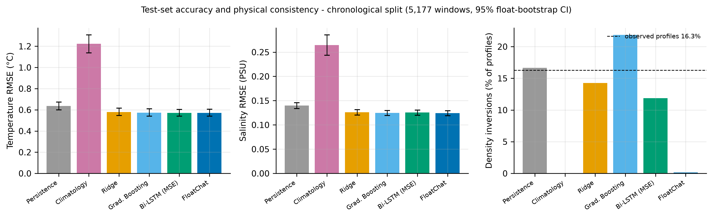

*Figure 3.1. Test RMSE with 95 % CI and inversion rate - chronological split.*

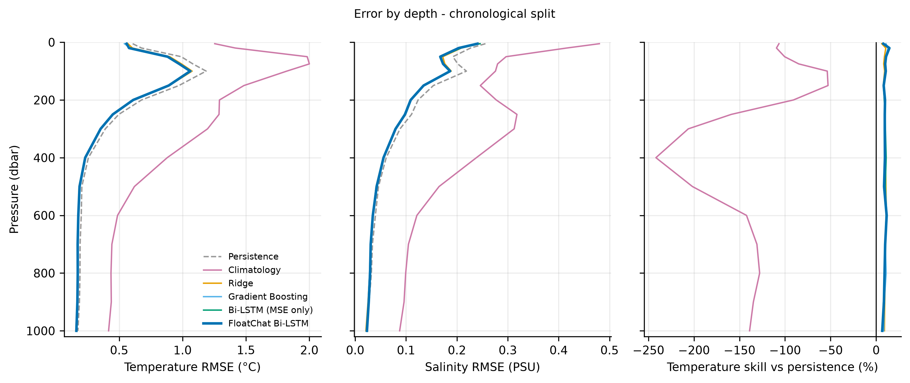

*Figure 3.2. RMSE and skill by depth - chronological split.*

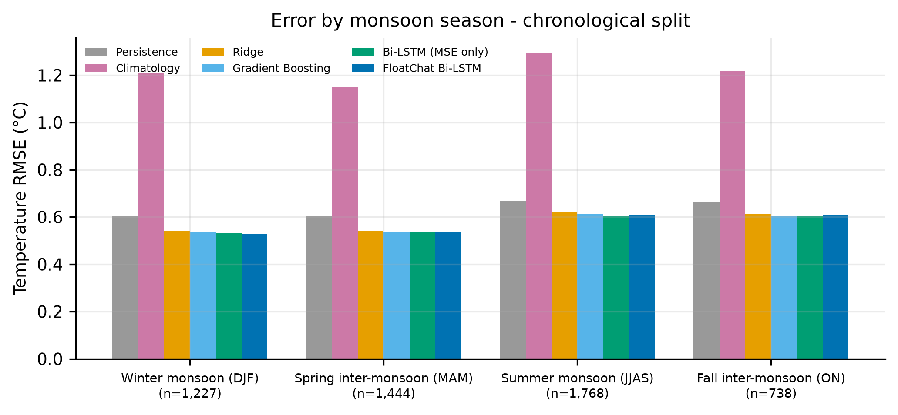

*Figure 3.3. RMSE by monsoon season - chronological split.*

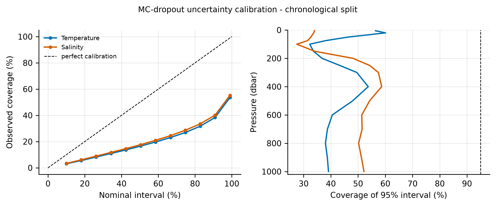

*Figure 3.4. MC-dropout calibration - chronological split.*

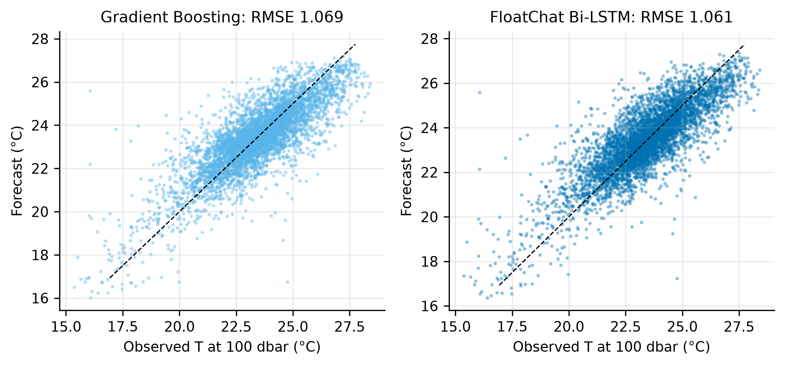

*Figure 3.5. Forecast vs observed temperature at 100 dbar.*

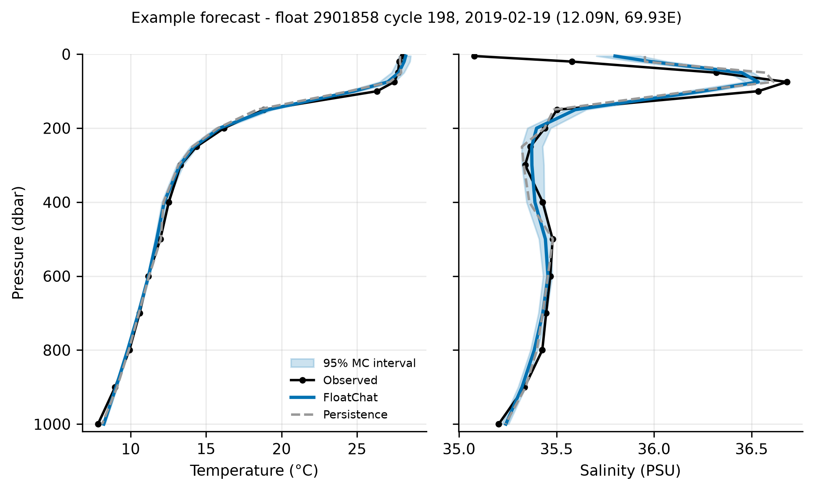

*Figure 3.6. Example forecast (median-error window).*

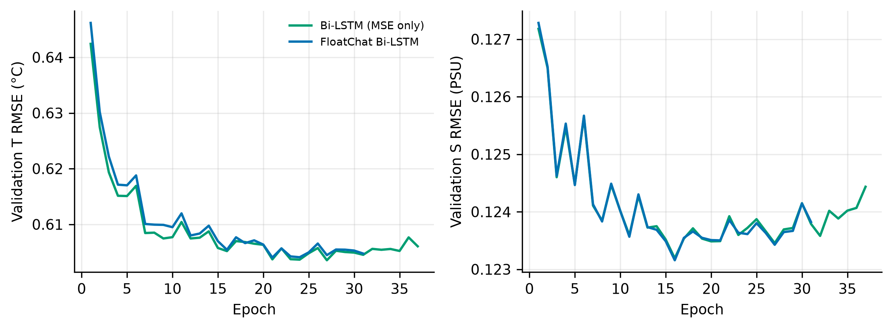

*Figure 3.7. Validation curves of the neural models.*

## 4. Forecast accuracy - unseen floats split

Test set: 4,341 windows from 45 floats. RMSE in physical units; 95 % CI from a float-level block bootstrap (1000 resamples). Neural models: seed 42 for the CI columns, mean +/- std over seeds 42, 43, 44 in the last columns.

| Model | T RMSE (C) | T 95% CI | T MAE | Thermocline RMSE 50-150 | Deep RMSE 500-1000 | T R2 | S RMSE (PSU) | S 95% CI | S R2 | Inversions TEOS-10 (%) | Inversions poly (%) | T RMSE seeds | S RMSE seeds |
|---|---|---|---|---|---|---|---|---|---|---|---|---|---|
| Persistence | 0.650 | [0.583, 0.750] | 0.369 | 0.989 | 0.277 | 0.990 | 0.131 | [0.124, 0.139] | 0.910 | 19.21 | 31.44 | - | - |
| Climatology | 1.352 | [1.248, 1.472] | 0.954 | 1.964 | 0.576 | 0.959 | 0.296 | [0.269, 0.330] | 0.545 | 0.00 | 0.00 | - | - |
| Ridge | 0.594 | [0.532, 0.682] | 0.345 | 0.916 | 0.242 | 0.992 | 0.118 | [0.112, 0.125] | 0.928 | 12.44 | 13.22 | - | - |
| Gradient Boosting | 0.584 | [0.525, 0.662] | 0.342 | 0.903 | 0.238 | 0.992 | 0.118 | [0.111, 0.126] | 0.928 | 19.56 | 20.96 | - | - |
| Bi-LSTM (MSE only) | 0.582 | [0.524, 0.658] | 0.345 | 0.897 | 0.240 | 0.992 | 0.117 | [0.111, 0.124] | 0.929 | 14.77 | 15.55 | 0.582 +/- 0.002 | 0.117 +/- 0.000 |
| **FloatChat Bi-LSTM** | 0.583 | [0.525, 0.659] | 0.347 | 0.899 | 0.240 | 0.992 | 0.117 | [0.111, 0.124] | 0.928 | 0.35 | 0.39 | 0.584 +/- 0.001 | 0.117 +/- 0.000 |
| Observed profiles | - | - | - | - | - | - | - | - | - | 19.07 | 31.40 | - | - |

Skill against persistence (1 - RMSE_model / RMSE_persistence; positive = better):

| Model | T skill | T skill 95% CI | S skill | Bootstrap share with skill <= 0 |
|---|---|---|---|---|
| Climatology | -107.9% | [-128.5%, -87.2%] | -125.2% | 1.000 |
| Ridge | 8.7% | [7.8%, 9.5%] | 10.1% | 0.000 |
| Gradient Boosting | 10.2% | [8.3%, 11.9%] | 10.1% | 0.000 |
| Bi-LSTM (MSE only) | 10.6% | [8.6%, 12.6%] | 10.8% | 0.000 |
| FloatChat Bi-LSTM | 10.4% | [8.3%, 12.4%] | 10.7% | 0.000 |

Summary: FloatChat temperature RMSE is 0.583 C against 0.650 C for persistence (skill 10.4 %, 95 % CI 8.3 to 12.4 %). Lowest temperature RMSE on this split: Bi-LSTM (MSE only); lowest salinity RMSE: Bi-LSTM (MSE only). FloatChat produced density inversions in 0.35 % of forecast profiles (TEOS-10 check), compared with 19.07 % in the observed profiles. Removing the physics terms (Bi-LSTM MSE only) gives 14.77 % inversions and 0.582 C RMSE.

Temperature RMSE by depth (C):

| dbar | Persistence | Climatology | Ridge | Gradient Boosting | Bi-LSTM (MSE only) | FloatChat Bi-LSTM |
|---|---|---|---|---|---|---|
| 5 | 0.556 | 1.263 | 0.527 | 0.504 | 0.537 | 0.546 |
| 20 | 0.744 | 1.393 | 0.677 | 0.660 | 0.667 | 0.671 |
| 50 | 0.920 | 2.027 | 0.853 | 0.844 | 0.842 | 0.845 |
| 75 | 0.980 | 2.101 | 0.914 | 0.902 | 0.901 | 0.903 |
| 100 | 1.105 | 2.038 | 1.018 | 1.004 | 0.995 | 0.998 |
| 150 | 0.938 | 1.657 | 0.870 | 0.855 | 0.840 | 0.840 |
| 200 | 0.746 | 1.558 | 0.668 | 0.660 | 0.646 | 0.646 |
| 250 | 0.653 | 1.603 | 0.576 | 0.567 | 0.554 | 0.554 |
| 300 | 0.577 | 1.473 | 0.512 | 0.499 | 0.490 | 0.489 |
| 400 | 0.469 | 1.071 | 0.402 | 0.395 | 0.389 | 0.389 |
| 500 | 0.379 | 0.763 | 0.319 | 0.312 | 0.312 | 0.312 |
| 600 | 0.319 | 0.593 | 0.271 | 0.264 | 0.266 | 0.266 |
| 700 | 0.263 | 0.530 | 0.230 | 0.223 | 0.228 | 0.228 |
| 800 | 0.234 | 0.516 | 0.209 | 0.206 | 0.212 | 0.212 |
| 900 | 0.223 | 0.515 | 0.201 | 0.203 | 0.203 | 0.203 |
| 1000 | 0.207 | 0.494 | 0.196 | 0.199 | 0.198 | 0.198 |

Salinity RMSE by depth (PSU):

| dbar | Persistence | Climatology | Ridge | Gradient Boosting | Bi-LSTM (MSE only) | FloatChat Bi-LSTM |
|---|---|---|---|---|---|---|
| 5 | 0.2022 | 0.4423 | 0.1939 | 0.1919 | 0.1903 | 0.1905 |
| 20 | 0.1983 | 0.4024 | 0.1809 | 0.1777 | 0.1758 | 0.1761 |
| 50 | 0.1745 | 0.3324 | 0.1562 | 0.1549 | 0.1541 | 0.1541 |
| 75 | 0.1801 | 0.3117 | 0.1601 | 0.1577 | 0.1588 | 0.1589 |
| 100 | 0.1965 | 0.3174 | 0.1710 | 0.1693 | 0.1689 | 0.1690 |
| 150 | 0.1411 | 0.3059 | 0.1262 | 0.1259 | 0.1242 | 0.1241 |
| 200 | 0.1467 | 0.3771 | 0.1277 | 0.1307 | 0.1296 | 0.1296 |
| 250 | 0.1374 | 0.4159 | 0.1202 | 0.1247 | 0.1230 | 0.1229 |
| 300 | 0.1135 | 0.3872 | 0.1016 | 0.1077 | 0.1050 | 0.1049 |
| 400 | 0.0822 | 0.2773 | 0.0738 | 0.0748 | 0.0746 | 0.0746 |
| 500 | 0.0650 | 0.1859 | 0.0564 | 0.0575 | 0.0569 | 0.0570 |
| 600 | 0.0566 | 0.1333 | 0.0483 | 0.0495 | 0.0485 | 0.0485 |
| 700 | 0.0480 | 0.1147 | 0.0423 | 0.0427 | 0.0422 | 0.0422 |
| 800 | 0.0441 | 0.1104 | 0.0387 | 0.0395 | 0.0395 | 0.0396 |
| 900 | 0.0396 | 0.1075 | 0.0349 | 0.0360 | 0.0360 | 0.0360 |
| 1000 | 0.0344 | 0.0999 | 0.0324 | 0.0328 | 0.0336 | 0.0336 |

Temperature RMSE by monsoon season (C):

| Model | Winter monsoon (DJF) (n=1,086) | Spring inter-monsoon (MAM) (n=1,060) | Summer monsoon (JJAS) (n=1,458) | Fall inter-monsoon (ON) (n=737) |
|---|---|---|---|---|
| Persistence | 0.665 | 0.543 | 0.708 | 0.652 |
| Climatology | 1.301 | 1.154 | 1.483 | 1.418 |
| Ridge | 0.596 | 0.479 | 0.659 | 0.603 |
| Gradient Boosting | 0.585 | 0.480 | 0.641 | 0.599 |
| Bi-LSTM (MSE only) | 0.587 | 0.481 | 0.638 | 0.588 |
| FloatChat Bi-LSTM | 0.589 | 0.482 | 0.640 | 0.589 |

Temperature RMSE by test year (C):

| Model | 2002 (n=59) | 2003 (n=141) | 2004 (n=172) | 2005 (n=116) | 2006 (n=28) | 2007 (n=52) | 2008 (n=131) | 2009 (n=288) | 2010 (n=213) | 2011 (n=152) | 2012 (n=87) | 2013 (n=123) | 2014 (n=319) | 2015 (n=557) | 2016 (n=639) | 2017 (n=333) | 2018 (n=274) | 2019 (n=217) | 2020 (n=167) | 2021 (n=57) | 2023 (n=6) | 2024 (n=62) | 2025 (n=68) | 2026 (n=80) |
|---|---|---|---|---|---|---|---|---|---|---|---|---|---|---|---|---|---|---|---|---|---|---|---|---|
| Persistence | 0.687 | 0.640 | 0.523 | 0.518 | 0.452 | 0.623 | 0.767 | 0.581 | 0.659 | 0.741 | 0.709 | 0.512 | 0.612 | 0.629 | 0.706 | 0.859 | 0.620 | 0.588 | 0.551 | 0.613 | 0.483 | 0.497 | 0.522 | 0.605 |
| Climatology | 1.220 | 1.034 | 1.144 | 0.991 | 0.522 | 1.381 | 1.826 | 1.284 | 1.417 | 1.383 | 1.603 | 0.938 | 1.295 | 1.397 | 1.515 | 1.537 | 1.188 | 1.241 | 1.355 | 1.589 | 1.611 | 1.246 | 0.792 | 1.057 |
| Ridge | 0.625 | 0.586 | 0.496 | 0.458 | 0.392 | 0.608 | 0.697 | 0.540 | 0.628 | 0.674 | 0.660 | 0.459 | 0.554 | 0.576 | 0.645 | 0.773 | 0.554 | 0.523 | 0.513 | 0.589 | 0.394 | 0.442 | 0.452 | 0.529 |
| Gradient Boosting | 0.630 | 0.563 | 0.484 | 0.446 | 0.397 | 0.612 | 0.695 | 0.529 | 0.628 | 0.691 | 0.649 | 0.462 | 0.549 | 0.572 | 0.628 | 0.742 | 0.541 | 0.523 | 0.486 | 0.586 | 0.431 | 0.431 | 0.447 | 0.527 |
| Bi-LSTM (MSE only) | 0.623 | 0.569 | 0.489 | 0.478 | 0.393 | 0.606 | 0.664 | 0.546 | 0.624 | 0.692 | 0.671 | 0.459 | 0.545 | 0.563 | 0.628 | 0.726 | 0.533 | 0.529 | 0.483 | 0.586 | 0.447 | 0.446 | 0.440 | 0.514 |
| FloatChat Bi-LSTM | 0.619 | 0.572 | 0.492 | 0.478 | 0.392 | 0.610 | 0.667 | 0.548 | 0.624 | 0.690 | 0.674 | 0.459 | 0.547 | 0.565 | 0.630 | 0.728 | 0.534 | 0.530 | 0.486 | 0.592 | 0.445 | 0.448 | 0.440 | 0.515 |

Uncertainty (FloatChat, 50-pass MC dropout):

| Variable | 90% coverage (Gaussian) | 95% coverage (Gaussian) | 90% coverage (quantile) | 95% coverage (quantile) | Mean 95% width |
|---|---|---|---|---|---|
| T | 41.2% | 47.4% | 39.7% | 44.8% | 0.514 |
| S | 43.8% | 50.1% | 42.4% | 47.6% | 0.092 |

A well-calibrated model covers close to 90 % and 95 %. Values well below mean the intervals are too narrow.

Training time on this machine (seconds, first seed):

| Model | Seconds |
|---|---|
| Ridge | 0 |
| Gradient Boosting | 18 |
| Bi-LSTM (MSE only) | 92 |
| FloatChat Bi-LSTM | 93 |

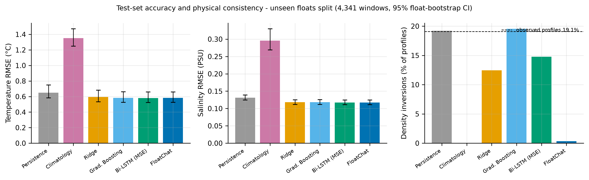

*Figure 4.1. Test RMSE with 95 % CI and inversion rate - unseen floats split.*

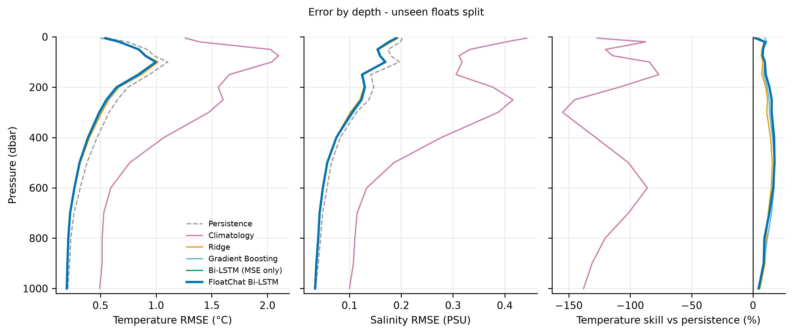

*Figure 4.2. RMSE and skill by depth - unseen floats split.*

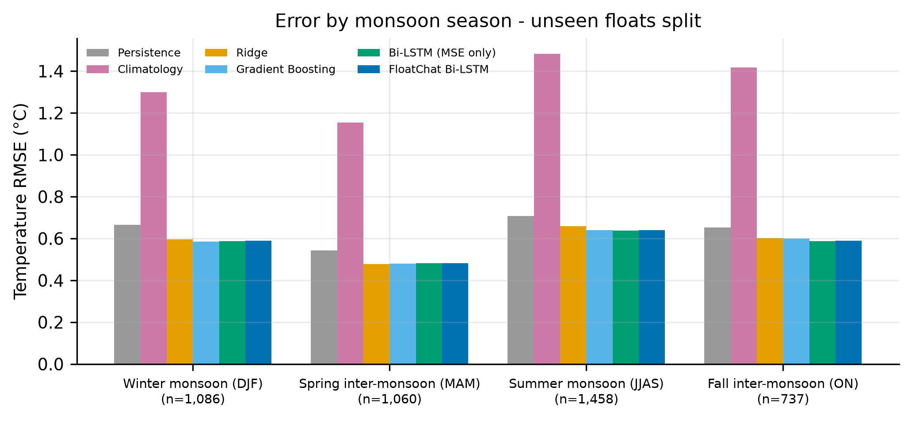

*Figure 4.3. RMSE by monsoon season - unseen floats split.*

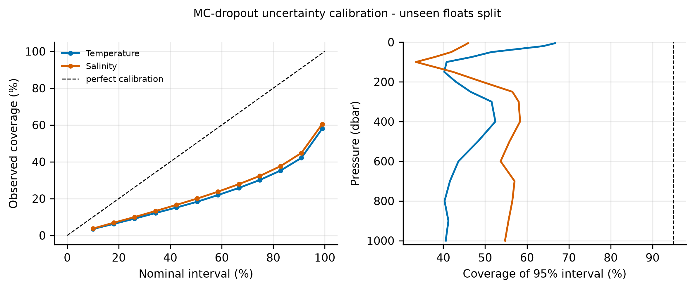

*Figure 4.4. MC-dropout calibration - unseen floats split.*

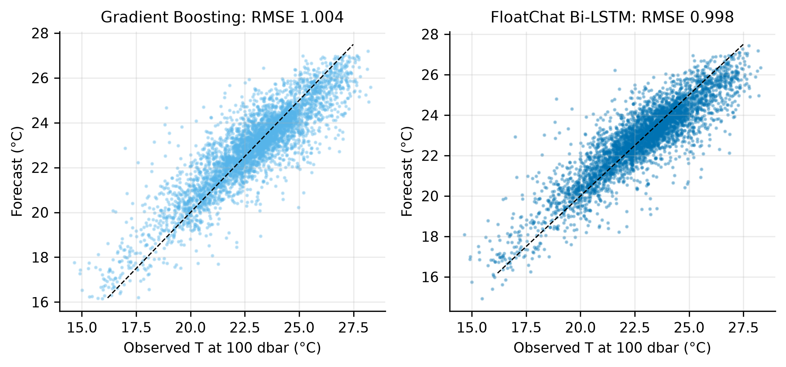

*Figure 4.5. Forecast vs observed temperature at 100 dbar.*

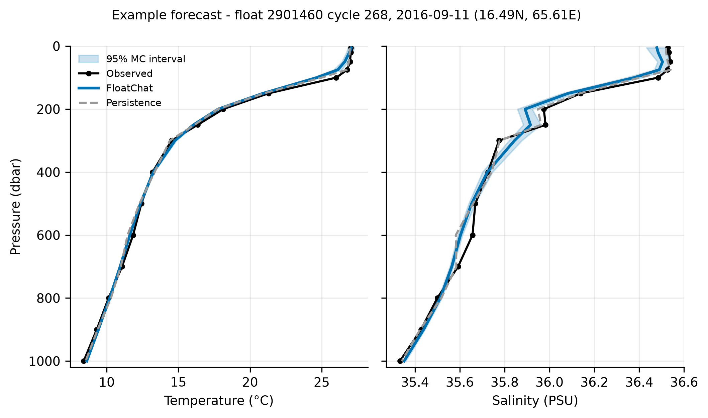

*Figure 4.6. Example forecast (median-error window).*

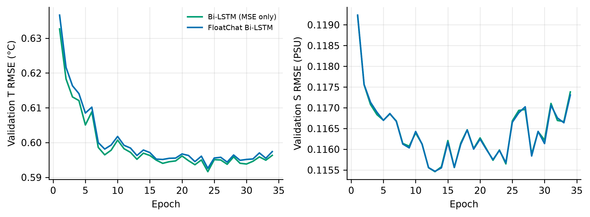

*Figure 4.7. Validation curves of the neural models.*

## 5. Comparison with the previous FloatChat run

Previous values are copied from the project documentation (109 floats, 18,192 profiles, 916 test windows from 5 held-out floats, including 5 sub-polar floats in training). The data, split and test set differ, so the comparison shows the change in scale and setting, not a paired test.

| Model | Prev T RMSE | Prev S RMSE | Prev thermocline | Prev inversions % | New chronological (T / S / therm / inv-poly %) | New unseen floats (T / S / therm / inv-poly %) |
|---|---|---|---|---|---|---|
| FloatChat Bi-LSTM | 0.512 | 0.107 | 0.803 | 0.00 | 0.572 / 0.124 / 0.955 / 0.15 | 0.583 / 0.117 / 0.899 / 0.39 |
| Gradient Boosting | 0.507 | 0.075 | 0.805 | 23.9 | 0.573 / 0.125 / 0.959 / 22.56 | 0.584 / 0.118 / 0.903 / 20.96 |
| Persistence | 0.544 | 0.110 | 0.859 | 21.0 | 0.636 / 0.140 / 1.061 / 27.95 | 0.650 / 0.131 / 0.989 / 31.44 |

## 6. Explainability: LIME vs SHAP vs FloatChat IG

Model explained: FloatChat Bi-LSTM, chronological split, seed 42. 100 test windows (stratified by season). LIME: 2000 perturbations; KernelSHAP: 1000 coalitions, 25-centre k-means background; IG: 64 steps, climatological baseline. Robustness noise: N(0, 0.05) in scaled units on 30 windows. Depth matrices from 20 windows.

### Target: Temperature at 100 dbar

| Method | Deletion AUC (higher better) | Insertion error AUC (lower better) | Faithfulness r | Robustness cos | Repeatability cos | Completeness error (median) | ms / explanation | Share on t-1 | Share on target variable | Share within +/-1 level |
|---|---|---|---|---|---|---|---|---|---|---|
| LIME | 1.044 | 0.244 | 0.978 +/- 0.013 | 0.990 | 0.994 | 0.238 | 65.1 | 64.2% | 62.3% | 28.9% |
| SHAP | 1.158 | 0.454 | 0.833 +/- 0.102 | 0.918 | 0.912 | 0.000 | 732.5 | 86.9% | 69.9% | 50.6% |
| **FloatChat IG** | 1.041 | 0.254 | 0.980 +/- 0.014 | 0.996 | 1.000 | 0.000 | 20.4 | 64.1% | 64.1% | 28.4% |
| Random order | 0.752 | 0.768 | - | - | - | - | - | - | - | - |

IG convergence delta: median 5.96e-08, max 2.38e-07.

| Pair | Spearman rank correlation | Top-10 overlap |
|---|---|---|
| LIME vs SHAP | 0.474 | 70% |
| LIME vs FloatChat IG | 0.881 | 86% |
| SHAP vs FloatChat IG | 0.482 | 72% |

Similarity of the 16x16 depth matrices (Pearson r):

| Pair | r |
|---|---|
| LIME vs SHAP | 0.983 |
| LIME vs FloatChat IG | 0.992 |
| SHAP vs FloatChat IG | 0.979 |

| Method | t-3 | t-2 | t-1 |
|---|---|---|---|
| LIME | 0.151 | 0.207 | 0.642 |
| SHAP | 0.039 | 0.092 | 0.869 |
| FloatChat IG | 0.155 | 0.204 | 0.641 |

Summary: highest deletion AUC - SHAP; highest faithfulness correlation - FloatChat IG; fastest - FloatChat IG (20.4 ms vs 733 ms for the slowest).

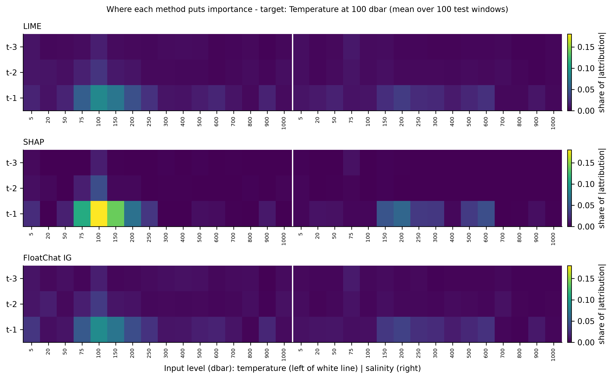

*Mean share of |attribution| per input (cycle x level) - Temperature at 100 dbar.*

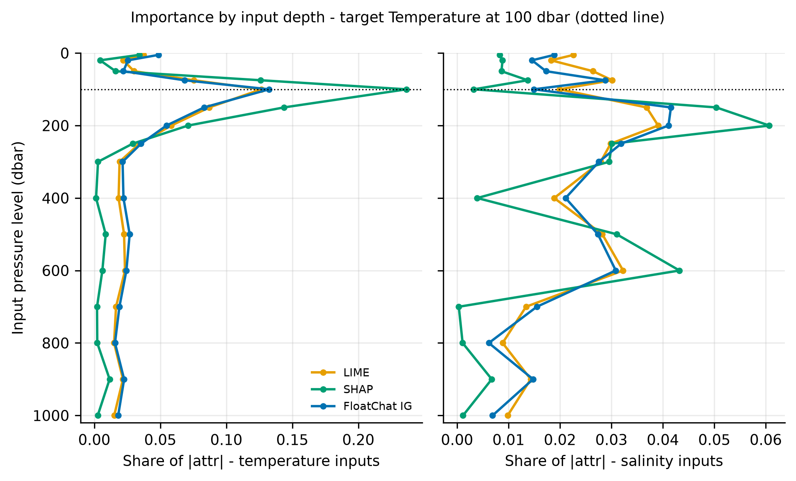

*Importance by input depth - Temperature at 100 dbar.*

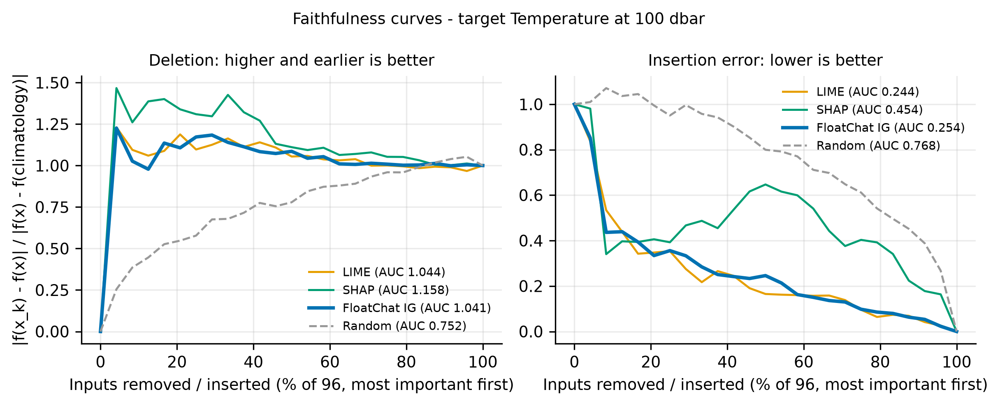

*Deletion and insertion curves - Temperature at 100 dbar.*

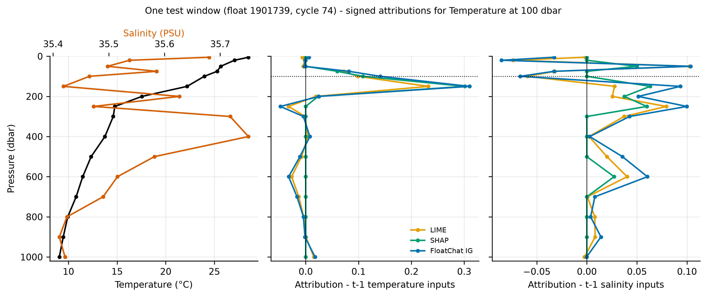

*Signed attributions for one test window - Temperature at 100 dbar.*

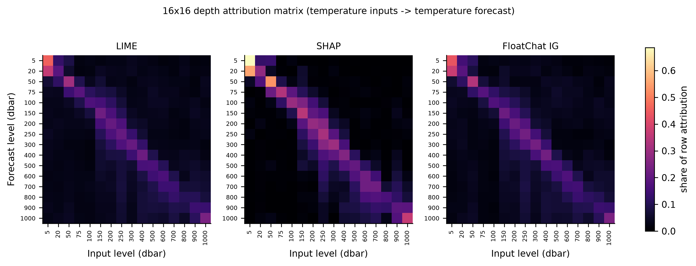

*16x16 depth attribution matrices for the three methods.*

### Target: Salinity at 100 dbar

| Method | Deletion AUC (higher better) | Insertion error AUC (lower better) | Faithfulness r | Robustness cos | Repeatability cos | Completeness error (median) | ms / explanation | Share on t-1 | Share on target variable | Share within +/-1 level |
|---|---|---|---|---|---|---|---|---|---|---|
| LIME | 1.574 | 0.660 | 0.969 +/- 0.028 | 0.988 | 0.993 | 0.242 | 72.2 | 57.6% | 61.9% | 34.9% |
| SHAP | 1.488 | 0.656 | 0.835 +/- 0.125 | 0.958 | 0.961 | 0.000 | 769.1 | 76.7% | 74.2% | 60.0% |
| **FloatChat IG** | 1.301 | 0.723 | 0.968 +/- 0.029 | 0.995 | 1.000 | 0.000 | 21.5 | 59.2% | 61.2% | 35.7% |
| Random order | 1.224 | 1.429 | - | - | - | - | - | - | - | - |

IG convergence delta: median 4.10e-08, max 2.38e-07.

| Pair | Spearman rank correlation | Top-10 overlap |
|---|---|---|
| LIME vs SHAP | 0.475 | 72% |
| LIME vs FloatChat IG | 0.839 | 85% |
| SHAP vs FloatChat IG | 0.487 | 74% |

Similarity of the 16x16 depth matrices (Pearson r):

| Pair | r |
|---|---|
| LIME vs SHAP | 0.989 |
| LIME vs FloatChat IG | 0.994 |
| SHAP vs FloatChat IG | 0.992 |

| Method | t-3 | t-2 | t-1 |
|---|---|---|---|
| LIME | 0.189 | 0.234 | 0.576 |
| SHAP | 0.095 | 0.138 | 0.767 |
| FloatChat IG | 0.190 | 0.218 | 0.592 |

Summary: highest deletion AUC - LIME; highest faithfulness correlation - LIME; fastest - FloatChat IG (21.5 ms vs 769 ms for the slowest).

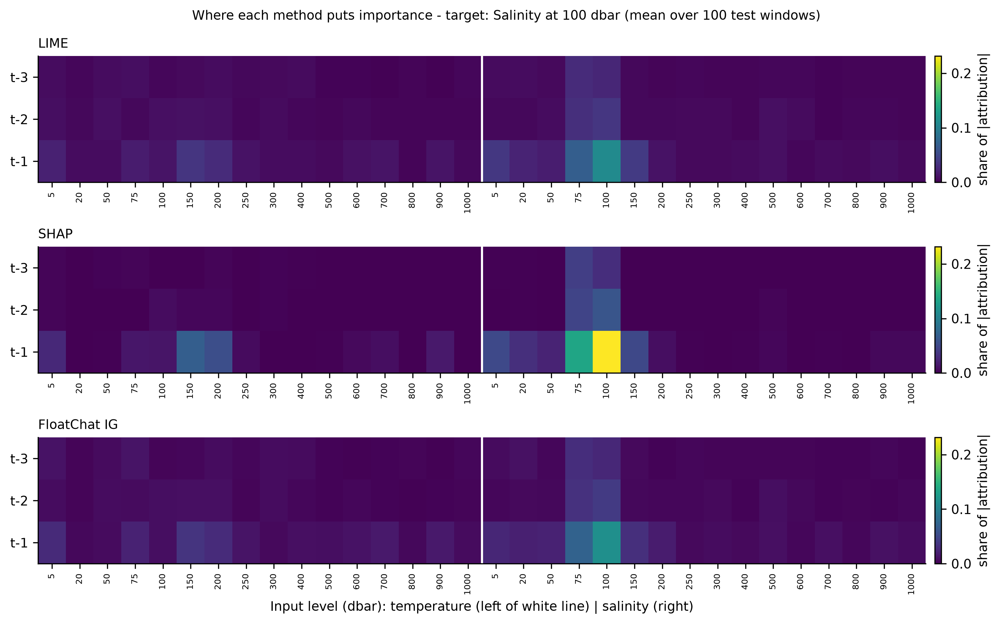

*Mean share of |attribution| per input (cycle x level) - Salinity at 100 dbar.*

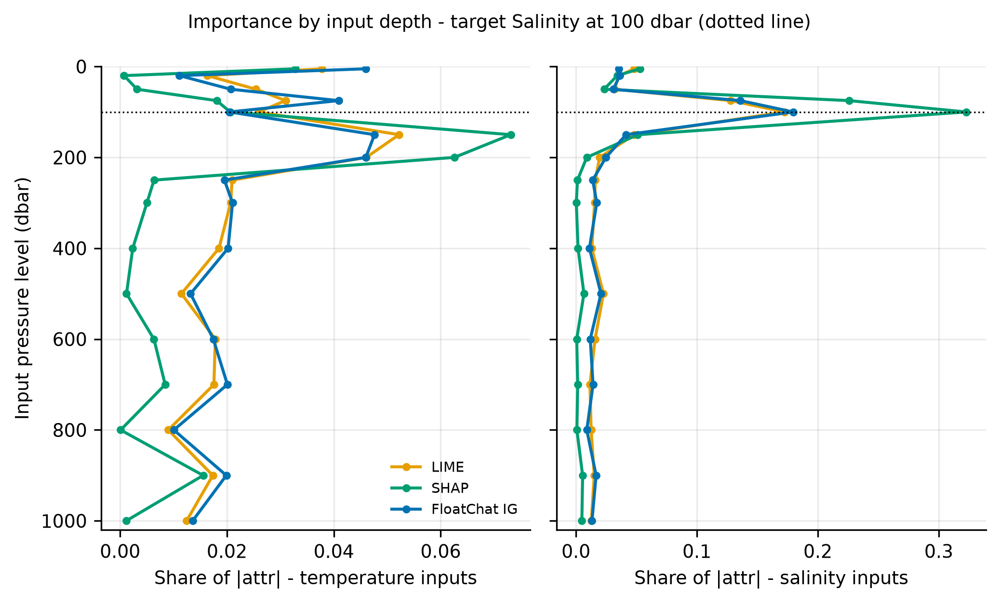

*Importance by input depth - Salinity at 100 dbar.*

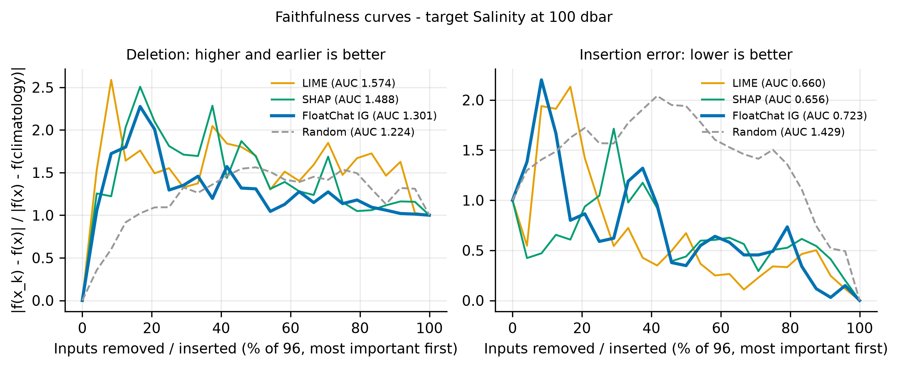

*Deletion and insertion curves - Salinity at 100 dbar.*

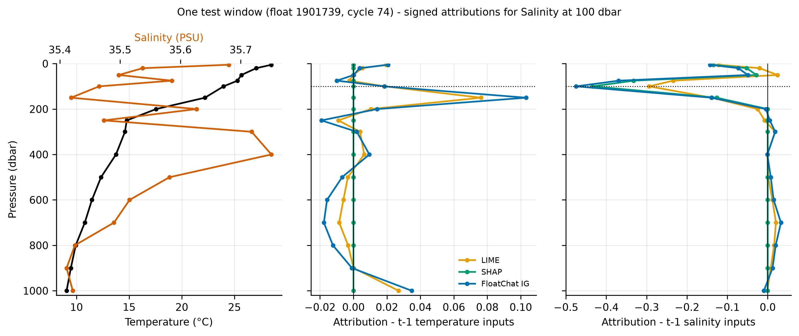

*Signed attributions for one test window - Salinity at 100 dbar.*

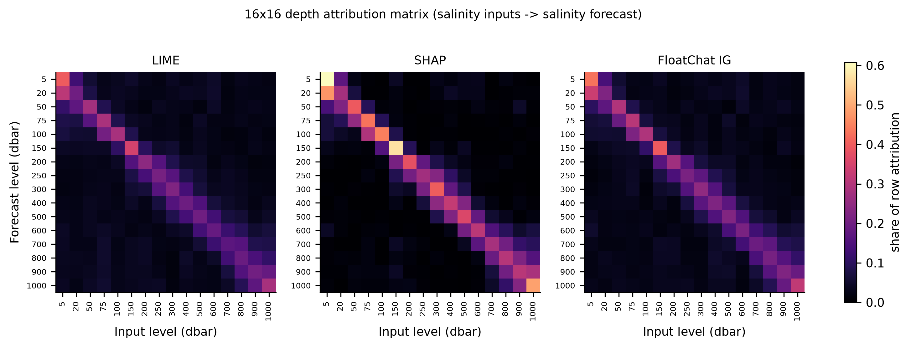

*16x16 depth attribution matrices for the three methods.*

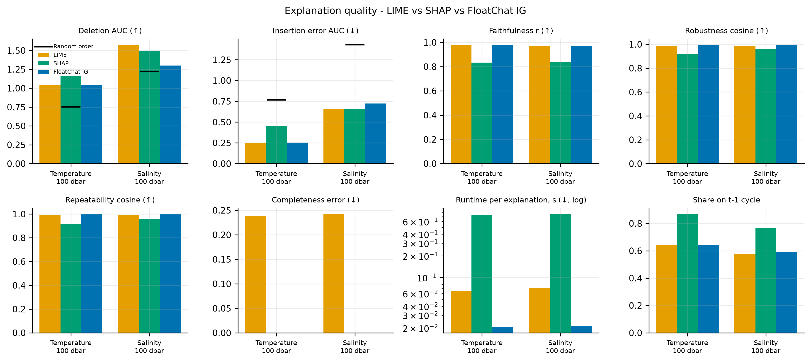

*Explanation-quality metrics side by side.*

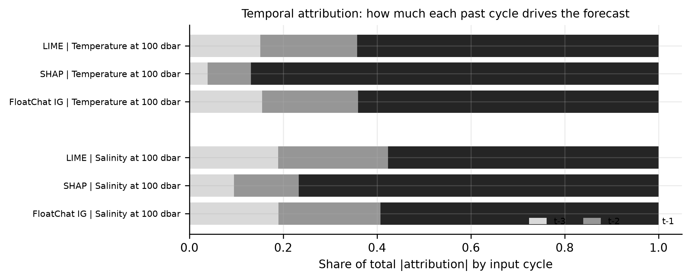

*Temporal attribution by method and target.*

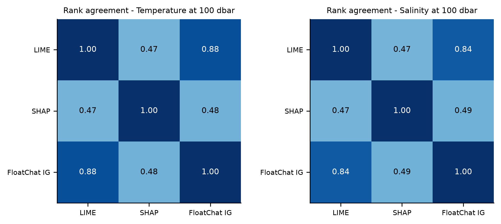

*Rank agreement between methods.*

## 7. Reproducibility

| Item | Value |
|---|---|
| python | 3.11.0 |
| platform | Windows-10-10.0.26200-SP0 |
| processor | AMD64 Family 23 Model 113 Stepping 0, AuthenticAMD |
| numpy | 1.26.4 |
| pandas | 3.0.6 |
| torch | 2.5.1+cu118 |
| sklearn | 1.9.1 |
| xarray | 2026.7.0 |
| gsw | 3.6.20 |
| shap | 0.49.1 |
| lime | installed |
| captum | 0.9.0 |
| device | cuda:NVIDIA GeForce RTX 3060 Ti |
| torch_threads | 6 |
| Total stage-4 runtime | 9.4 min |
| Command | `python run_all.py` (see README.md in this folder) |

Files: `outputs/tables/` (all metrics as JSON/CSV), `outputs/predictions/` (test predictions), `outputs/models/` (weights and scalers), `outputs/figures/` (PNG 300 dpi and PDF).
